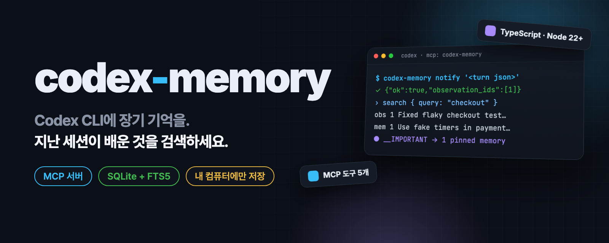
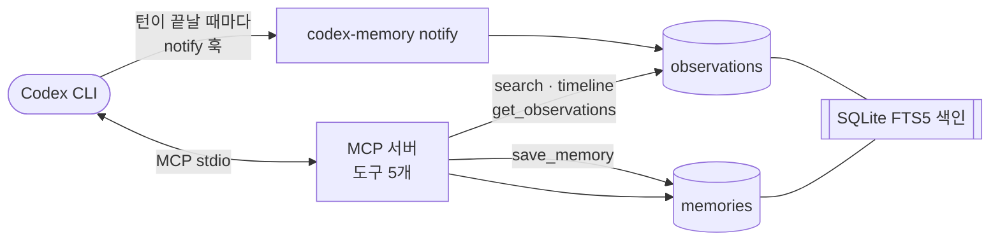

<p align="center">
  
</p>

<p align="center">
  <a href="README.md"><b>English</b></a> · <b>한국어</b>
</p>

<h2 align="center">Codex CLI에 장기 기억을.<br>지난 세션이 배운 것을 검색하세요.</h2>

<p align="center">
  Codex의 매 턴을 로컬 SQLite에 기록하는 MCP 서버 + notify 훅.<br>
  결정·버그 수정·교훈이 세션과 프로젝트를 넘어 이어집니다.
</p>

<p align="center">
  <a href="LICENSE"></a>
  <a href="https://github.com/kks0488/codex-memory/stargazers"></a>
  
  <a href="https://github.com/kks0488/codex-memory/commits/main"></a>
  
</p>

<table>
<tr>
<td width="50%" valign="top">

### 모든 턴을 기억
Codex의 `notify` 훅이 끝난 턴마다 `codex-memory notify`를 부르고, 저장소·스레드·사용자 요청과 함께 관찰(observation)로 저장합니다.

</td>
<td width="50%" valign="top">

### 직접 다듬는 기억
`save_memory`로 결정·수정·규칙·교훈을 중요도 1~5와 태그와 함께 저장합니다. 고정(pin)한 기억은 `__IMPORTANT`가 먼저 보여 줍니다.

</td>
</tr>
<tr>
<td width="50%" valign="top">

### 필요한 만큼만 토큰 사용
검색은 제목과 스니펫만 먼저 돌려줍니다. `timeline`으로 앞뒤 맥락을 보고, `get_observations`로 고른 ID의 전체 내용만 불러옵니다.

</td>
<td width="50%" valign="top">

### 내 컴퓨터, 저장소별 구분
모든 기록은 `~/.codex/memory/` 아래 SQLite 파일 하나에 남습니다. git remote(`user/repo`)로 구분하고, `timeline`은 기준 기록의 저장소 안에서만 찾습니다.

</td>
</tr>
</table>

## 설치

필요한 것: Node.js 22 이상, [Codex CLI](https://github.com/openai/codex).

```bash
git clone https://github.com/kks0488/codex-memory.git
cd codex-memory
npm install
npm run build
```

## 빠른 시작

1. Codex에 MCP 서버 등록 (받은 폴더 안에서 실행):

   ```bash
   codex mcp add codex-memory -- node "$PWD/dist/server.js"
   ```

2. `~/.codex/config.toml`에 notify 훅 추가. `notify`는 최상위 키라서 `[표]` 구역보다 위에 둡니다.

   ```toml
   notify = ["node", "/path/to/codex-memory/dist/cli.js", "notify"]
   ```

   전체 예시는 [`codex-config-example.toml`](codex-config-example.toml)에 있습니다.

3. Codex를 시작합니다. 세션 시작 때 `__IMPORTANT`, 작업 전 `search`, 남길 만한 게 생기면 `save_memory`를 부르도록 하세요.

훅을 손으로 시험해 보기:

```bash
node dist/cli.js notify '{"type":"agent-turn-complete","thread-id":"t-01","last-assistant-message":"Fixed flaky checkout test"}'
# {"ok":true,"observation_ids":[1]}
```

## 데모

<p align="center">
  
</p>

위 출력은 임시 데이터베이스와 예제 저장소로 실제 로컬 실행한 결과입니다.

## MCP 도구

| 도구 | 하는 일 | 입력 | 출력 |
|---|---|---|---|
| `search` | FTS5 BM25 키워드 검색 (1단계) | `query`, `repo_id?`, `type?`, `limit?` | `{results: [{id, table, title, snippet, score, created_at, kind?, memory_type?}]}` |
| `timeline` | 기준 기록 앞뒤 시간대, 같은 저장소 (2단계) | `anchor_id`, `anchor_table?`, `window_min?`(기본 30), `repo_id?` | `{timeline: [{id, table, title, created_at}]}` |
| `get_observations` | ID 목록의 전체 기록 (3단계) | `ids[]` | `{items: [{id, title, content, kind, scope, cwd, meta_json, ...}]}` |
| `save_memory` | 기억 저장, 또는 같은 저장소의 기억 수정 | `title`, `body`, `memory_type`, `importance?`, `tags?`, `pinned?`, `update_id?`, ... | `{memory_id, created_at}` |
| `__IMPORTANT` | 사용 안내 + 고정된 기억 | `repo_id?` | 안내 문서 + 고정 목록 |

## 작동 방식



**관찰(Observation)과 기억(Memory)**

| | 관찰 | 기억 |
|---|---|---|
| **성격** | 무슨 일이 있었는지 원본 기록 | 알아 둬야 할 정제된 지식 |
| **양** | 많고 거침 | 적고 정제됨 |
| **예시** | 턴 요약, 파일 변경, 도구 사용 | 규칙, 결정, 교훈, 선호 |
| **만드는 방법** | notify 훅이 자동으로 | `save_memory` |

<details>
<summary><b>기술 세부 사항</b></summary>

### 데이터 모델

```sql
CREATE TABLE observations (
  id INTEGER PRIMARY KEY AUTOINCREMENT,
  created_at INTEGER NOT NULL,        -- Unix epoch 밀리초
  repo_id TEXT NOT NULL,              -- git remote 기반 (예: user/repo), git이 아니면 _local/<폴더>
  thread_id TEXT,                     -- Codex 세션 ID
  turn_id TEXT,
  scope TEXT NOT NULL DEFAULT 'repo', -- 'global', 'repo', 'thread'
  cwd TEXT,
  kind TEXT NOT NULL,                 -- turn_summary, file_change, tool_use, error, decision, custom
  title TEXT,                         -- 첫 줄, 최대 80자
  content TEXT NOT NULL,
  meta_json TEXT                      -- Codex가 보내면 input_messages 포함
);

CREATE TABLE memories (
  id INTEGER PRIMARY KEY AUTOINCREMENT,
  created_at INTEGER NOT NULL,
  updated_at INTEGER NOT NULL,
  repo_id TEXT NOT NULL,
  memory_type TEXT NOT NULL,          -- decision, fix, rule, preference, pattern, architecture, lesson, custom
  title TEXT NOT NULL,
  body TEXT NOT NULL,
  importance INTEGER NOT NULL DEFAULT 3,      -- 1-5
  tags_json TEXT NOT NULL DEFAULT '[]',
  source_obs_ids TEXT NOT NULL DEFAULT '[]',
  pinned INTEGER NOT NULL DEFAULT 0,
  expires_at INTEGER,
  status TEXT NOT NULL DEFAULT 'active'       -- active, draft, superseded, quarantined
);
```

전문 검색은 외부 콘텐츠 FTS5 테이블을 쓰고, INSERT/UPDATE/DELETE 트리거로 자동 동기화합니다. `repo_id`(와 `memory_type`)는 `UNINDEXED` 열이라 JOIN 없이 걸러낼 수 있습니다.

```sql
CREATE VIRTUAL TABLE obs_fts USING fts5(title, content, repo_id UNINDEXED,
  content='observations', content_rowid='id');
CREATE VIRTUAL TABLE mem_fts USING fts5(title, body, repo_id UNINDEXED, memory_type UNINDEXED,
  content='memories', content_rowid='id');
```

### 동작 메모

- 데이터베이스는 `~/.codex/memory/codex-memory.db` (WAL 모드)입니다.
- `repo_id`는 프로세스 작업 폴더의 `git remote get-url origin`에서 가져오고, git이 아니면 `_local/<폴더 이름>`입니다.
- `update_id`가 있는 `save_memory`는 같은 `repo_id`의 기억만 고칩니다.
- notify 페이로드는 Zod로 검증합니다. `agent-turn-complete`는 `turn_summary` 관찰이 되고, 다른 이벤트는 이름에서 종류를 정해 저장합니다.
- `__IMPORTANT`는 해당 저장소와 `_global`에 저장된 고정·활성 기억을 보여 줍니다.

### 기술 스택

| 영역 | 기술 |
|---|---|
| 언어 | TypeScript (Node 22+, ESM) |
| DB | SQLite (better-sqlite3) + FTS5 + WAL |
| MCP | @modelcontextprotocol/sdk (stdio transport) |
| 검증 | Zod |

### 폴더 구조

```
codex-memory/
├── src/
│   ├── server.ts          # MCP 서버 시작점
│   ├── cli.ts             # CLI 시작점 (codex-memory notify)
│   ├── ingest.ts          # notify 페이로드 → 관찰 저장
│   ├── db.ts              # SQLite + FTS5 스키마, 저장, 검색
│   ├── paths.ts           # 데이터 폴더와 DB 경로
│   ├── repo.ts            # git remote로 repo_id 감지
│   ├── types.ts
│   └── tools/             # search, timeline, get-observations, save-memory, important
├── codex-config-example.toml
└── REVIEW.md              # MVP 코드 리뷰와 반영 내역
```

### 참고

- [claude-mem](https://github.com/thedotmack/claude-mem): 영감을 준 Claude Code 프로젝트
- [Codex MCP 가이드](https://developers.openai.com/codex/mcp/)
- [Codex config 레퍼런스](https://developers.openai.com/codex/config-reference/)
- [Codex memory 기능 요청 #4933](https://github.com/openai/codex/issues/4933)

</details>

## 자주 묻는 질문

**밖으로 나가는 데이터가 있나요?**
없습니다. codex-memory는 네트워크를 쓰지 않고 로컬 SQLite 파일만 읽고 씁니다. Codex가 자기 모델에 무엇을 보내는지는 Codex 설정에 따릅니다.

**`codex resume`과 뭐가 다른가요?**
`codex resume`은 한 세션을 이어 갑니다. codex-memory는 세션과 프로젝트를 넘어 검색할 수 있는 지식을 남깁니다.

**npm에 있나요?**
아직 없습니다. 위처럼 소스에서 설치하세요.

## 로드맵 (계획, 아직 미구현)

- `search`에 `since`, `tags` 필터
- 검색·timeline 저장소 분리·트리거 동기화 자동 테스트
- 지난 세션 일괄 가져오기 (`ingest-jsonl`)
- 로컬 웹 뷰어
- 관찰을 초안 기억으로 자동 승격

## 라이선스

MIT © Kyoungsoo Kim. [LICENSE](LICENSE)를 보세요. OpenAI와 제휴하거나 보증받지 않은 프로젝트입니다.
