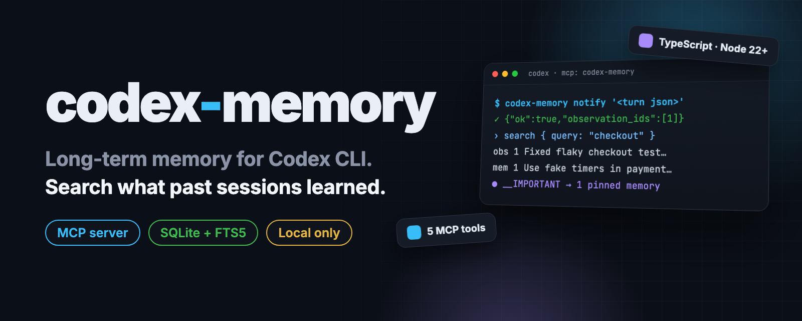
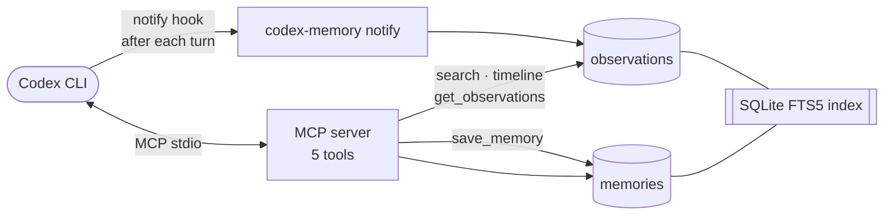

<p align="center">
  
</p>

<p align="center">
  <b>English</b> · <a href="README.ko.md"><b>한국어</b></a>
</p>

<h2 align="center">Long-term memory for Codex CLI.<br>Search what past sessions learned.</h2>

<p align="center">
  An MCP server plus a notify hook that records every Codex turn into a local SQLite database,<br>
  so decisions, fixes and lessons carry over between sessions and projects.
</p>

<p align="center">
  <a href="LICENSE"></a>
  <a href="https://github.com/kks0488/codex-memory/stargazers"></a>
  
  <a href="https://github.com/kks0488/codex-memory/commits/main"></a>
  
</p>

<table>
<tr>
<td width="50%" valign="top">

### Remembers every turn
Codex's `notify` hook sends each finished turn to `codex-memory notify`, which saves it as an observation with the repo, thread and your request.

</td>
<td width="50%" valign="top">

### Curated memories you control
`save_memory` stores decisions, fixes, rules and lessons with importance 1–5 and tags. Pinned memories are shown first by `__IMPORTANT`.

</td>
</tr>
<tr>
<td width="50%" valign="top">

### Spends tokens only when needed
Search returns titles and snippets first. `timeline` adds nearby context, and `get_observations` loads full text only for the IDs you pick.

</td>
<td width="50%" valign="top">

### Local and per-repo
Everything stays in one SQLite file under `~/.codex/memory/`. Records are tagged by git remote (`user/repo`), and `timeline` stays inside the anchor's repo.

</td>
</tr>
</table>

## Install

Requirements: Node.js 22+ and [Codex CLI](https://github.com/openai/codex).

```bash
git clone https://github.com/kks0488/codex-memory.git
cd codex-memory
npm install
npm run build
```

## Quick start

1. Register the MCP server with Codex (run inside the cloned folder):

   ```bash
   codex mcp add codex-memory -- node "$PWD/dist/server.js"
   ```

2. Add the notify hook to `~/.codex/config.toml`. `notify` is a top-level key, so put it above any `[table]`:

   ```toml
   notify = ["node", "/path/to/codex-memory/dist/cli.js", "notify"]
   ```

   A complete example is in [`codex-config-example.toml`](codex-config-example.toml).

3. Start Codex. Ask it to call `__IMPORTANT` at the start of a session, `search` before a task, and `save_memory` when something is worth keeping.

To try the hook by hand:

```bash
node dist/cli.js notify '{"type":"agent-turn-complete","thread-id":"t-01","last-assistant-message":"Fixed flaky checkout test"}'
# {"ok":true,"observation_ids":[1]}
```

## Demo

<p align="center">
  
</p>

The output above comes from a real local run against a throwaway database and a sample repo.

## MCP tools

| Tool | What it does | Input | Output |
|---|---|---|---|
| `search` | FTS5 BM25 keyword search (layer 1) | `query`, `repo_id?`, `type?`, `limit?` | `{results: [{id, table, title, snippet, score, created_at, kind?, memory_type?}]}` |
| `timeline` | Records around an anchor in time, same repo (layer 2) | `anchor_id`, `anchor_table?`, `window_min?` (default 30), `repo_id?` | `{timeline: [{id, table, title, created_at}]}` |
| `get_observations` | Full records for a list of IDs (layer 3) | `ids[]` | `{items: [{id, title, content, kind, scope, cwd, meta_json, ...}]}` |
| `save_memory` | Create a memory, or update one in the same repo | `title`, `body`, `memory_type`, `importance?`, `tags?`, `pinned?`, `update_id?`, ... | `{memory_id, created_at}` |
| `__IMPORTANT` | Usage guide plus pinned memories | `repo_id?` | guide text + pinned list |

## How it works



**Observations vs memories**

| | Observation | Memory |
|---|---|---|
| **What** | Raw record of what happened | Curated knowledge you should keep |
| **Volume** | Many, rough | Few, refined |
| **Examples** | Turn summaries, file changes, tool use | Rules, decisions, lessons, preferences |
| **Created by** | The notify hook, automatically | `save_memory` |

<details>
<summary><b>Technical details</b></summary>

### Data model

```sql
CREATE TABLE observations (
  id INTEGER PRIMARY KEY AUTOINCREMENT,
  created_at INTEGER NOT NULL,        -- Unix epoch milliseconds
  repo_id TEXT NOT NULL,              -- from git remote (e.g. user/repo), or _local/<folder>
  thread_id TEXT,                     -- Codex session ID
  turn_id TEXT,
  scope TEXT NOT NULL DEFAULT 'repo', -- 'global', 'repo', 'thread'
  cwd TEXT,
  kind TEXT NOT NULL,                 -- turn_summary, file_change, tool_use, error, decision, custom
  title TEXT,                         -- first line, up to 80 characters
  content TEXT NOT NULL,
  meta_json TEXT                      -- includes input_messages when Codex sends them
);

CREATE TABLE memories (
  id INTEGER PRIMARY KEY AUTOINCREMENT,
  created_at INTEGER NOT NULL,
  updated_at INTEGER NOT NULL,
  repo_id TEXT NOT NULL,
  memory_type TEXT NOT NULL,          -- decision, fix, rule, preference, pattern, architecture, lesson, custom
  title TEXT NOT NULL,
  body TEXT NOT NULL,
  importance INTEGER NOT NULL DEFAULT 3,      -- 1-5
  tags_json TEXT NOT NULL DEFAULT '[]',
  source_obs_ids TEXT NOT NULL DEFAULT '[]',
  pinned INTEGER NOT NULL DEFAULT 0,
  expires_at INTEGER,
  status TEXT NOT NULL DEFAULT 'active'       -- active, draft, superseded, quarantined
);
```

Full-text search uses external-content FTS5 tables kept in sync by insert/update/delete triggers. `repo_id` (and `memory_type`) are `UNINDEXED` columns so results can be filtered without a join:

```sql
CREATE VIRTUAL TABLE obs_fts USING fts5(title, content, repo_id UNINDEXED,
  content='observations', content_rowid='id');
CREATE VIRTUAL TABLE mem_fts USING fts5(title, body, repo_id UNINDEXED, memory_type UNINDEXED,
  content='memories', content_rowid='id');
```

### Behaviour notes

- The database is `~/.codex/memory/codex-memory.db` (WAL mode).
- `repo_id` comes from `git remote get-url origin` in the process's working folder; outside git it is `_local/<folder name>`.
- `save_memory` with `update_id` only changes a memory that belongs to the same `repo_id`.
- The notify payload is validated with Zod. `agent-turn-complete` events become `turn_summary` observations; other event types are stored with a kind derived from their name.
- `__IMPORTANT` lists pinned, active memories for the repo plus any stored under `_global`.

### Tech stack

| Area | Technology |
|---|---|
| Language | TypeScript (Node 22+, ESM) |
| Database | SQLite via better-sqlite3, FTS5, WAL |
| MCP | @modelcontextprotocol/sdk (stdio transport) |
| Validation | Zod |

### Project layout

```
codex-memory/
├── src/
│   ├── server.ts          # MCP server entry point
│   ├── cli.ts             # CLI entry (codex-memory notify)
│   ├── ingest.ts          # notify payload → observation
│   ├── db.ts              # SQLite + FTS5 schema, CRUD, search
│   ├── paths.ts           # data folder and DB path
│   ├── repo.ts            # repo_id from git remote
│   ├── types.ts
│   └── tools/             # search, timeline, get-observations, save-memory, important
├── codex-config-example.toml
└── REVIEW.md              # MVP code review and what was fixed
```

### References

- [claude-mem](https://github.com/thedotmack/claude-mem), the Claude Code project that inspired this one
- [Codex MCP guide](https://developers.openai.com/codex/mcp/)
- [Codex config reference](https://developers.openai.com/codex/config-reference/)
- [Codex memory feature request #4933](https://github.com/openai/codex/issues/4933)

</details>

## FAQ

**Does anything leave my machine?**
No. codex-memory makes no network calls; it reads and writes a local SQLite file. What Codex itself sends to its model is up to Codex.

**How is this different from `codex resume`?**
`codex resume` continues one session. codex-memory keeps searchable knowledge across sessions and projects.

**Is it on npm?**
Not yet. Install from source as shown above.

## Roadmap (planned, not built yet)

- `since` and `tags` filters for `search`
- Automated tests for search, timeline repo isolation and trigger sync
- Batch import of past sessions (`ingest-jsonl`)
- Local web viewer
- Automatic promotion of observations to draft memories

## License

MIT © Kyoungsoo Kim. See [LICENSE](LICENSE). Not affiliated with or endorsed by OpenAI.
